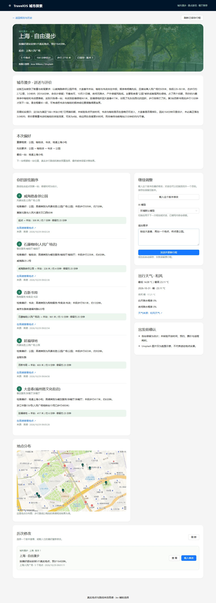

# TravelOS 城市探索助手

TravelOS 是一个基于多 Agent 的城市探索项目：从真实地点出发，规划城市漫步、查找景点或推荐餐厅。可以用表单指定偏好，也可以在已有行程上用自然语言提出修改，并查看历史版本。

## 功能展示

| 功能 | 能做什么 | 界面 |
| --- | --- | --- |
| 城市漫步 | 按兴趣、游览顺序、时间与步行距离规划路线，展示步行路段、天气和停留建议。 | [规划表单](docs/images/portfolio/01-citywalk-form.jpg) · [漫步结果与修改输入](docs/images/portfolio/07-citywalk-result-before.jpg) |
| 景点游览 | 结合起点和兴趣查找附近的景点，查看推荐理由及地图。 | [规划表单](docs/images/portfolio/02-attractions-form.jpg) · [景点结果](docs/images/portfolio/05-attractions-result.jpg) |
| 餐厅推荐 | 按餐食、菜系和距离寻找餐厅，查看推荐理由与地点分布。 | [规划表单](docs/images/portfolio/03-food-form.jpg) · [餐厅结果](docs/images/portfolio/06-food-result.jpg) |
| 对话规划和行程调整 | 使用自然语言表达目标，续接已有计划、保留指定地点，并查看历史版本。 | [对话入口](docs/images/portfolio/04-conversation-form.jpg) · [自然语言修改后的结果](docs/images/portfolio/08-citywalk-natural-language-update.jpg) |



图片展示真实界面与示例结果。地点、路线和地图由高德提供；封面是 Unsplash 氛围图，摄影师署名显示在页面内。调用外部服务时，结果可能因地点、日期、额度和服务可用性而变化。

## 运行环境

- Python 3.10 或以上，Node.js 20 或以上、npm，以及 PostgreSQL 14 或以上。
- 高德 Web 服务 Key：`AMAP_API_KEY`，用于地点、路线及地图。
- Unsplash Access Key：`UNSPLASH_ACCESS_KEY`，用于封面图片。
- OpenRouter API Key：`OPENROUTER_API_KEY`，用于 Jev 辅助判断。
- 至少一个生成模型 Key：例如 `DEEPSEEK_API_KEY`，用于理解需求和生成说明。
- 可选：和风天气的 `QWEATHER_API_HOST` 和 `QWEATHER_API_KEY`（或 `QWEATHER_JWT`）；未配置时天气会降级。

服务使用环境变量或本地 `backend/.env` 读取配置。复制模板后填写自己的密钥：

```bash
cd backend
cp .env.example .env
# 编辑 .env，填写上述密钥
```

Windows PowerShell 可使用 `Copy-Item .env.example .env`。在 `backend/.env` 中设置至少 32 字节的随机 `AUTH_CSRF_SECRET`；本地 HTTP 开发需设置 `AUTH_COOKIE_SECURE=false`。`.env` 含私有密钥，已被 Git 忽略；前端无需填写地图密钥。

## Docker 部署

项目提供 Docker Compose 配置，包含前端（Vue 构建产物和 Nginx）、FastAPI 后端、PostgreSQL 16 和一次性数据库迁移服务。需要 Docker Engine 和 Docker Compose 插件，以及可用的外部服务密钥。

首次部署时，在项目根目录准备配置：

```bash
mkdir -p deploy
cp backend/.env.example deploy/backend.env
# 编辑 deploy/backend.env：填写各服务密钥和至少 32 字节随机的 AUTH_CSRF_SECRET。
# 设置 CORS_ORIGINS 为浏览器访问地址，例如 http://服务器IP；若端口不是 80，需包含端口。
# 仅在使用 HTTP 时设置 AUTH_COOKIE_SECURE=false；配置 HTTPS 后设为 true。
python3 -c 'import secrets; print("POSTGRES_PASSWORD=" + secrets.token_hex(24) + "\nHTTP_PORT=80")' > .env
chmod 600 .env deploy/backend.env
```

上述生成命令会覆盖项目根目录已有的 `.env`；如果已部署过，请保留原文件和数据库密码。`deploy/backend.env` 中示例的 `DATABASE_URL` 会被 Compose 中指向数据库容器的配置覆盖。将 `AUTH_CSRF_SECRET` 设置为独立的随机值，例如运行 `python3 -c 'import secrets; print(secrets.token_urlsafe(48))'` 后写入配置文件。两份环境文件均包含敏感信息，不要提交到 Git 或公开分享。

```bash
docker compose config -q
docker compose up -d --build
docker compose ps
curl --fail http://127.0.0.1/health
```

默认访问 `http://服务器IP`，即 80 端口；如修改 `HTTP_PORT`，访问时需带端口并同步修改 `CORS_ORIGINS`。云服务器还需要在安全组放行对应端口。数据库和后端只在容器网络内访问，PostgreSQL 数据保存在 `postgres_data` 卷中。首次启动时 Compose 会等待数据库就绪，执行认证表迁移，再启动后端和前端。

当前服务器部署在 <http://47.114.72.128>，文件位于 `/opt/travelos`。这是独立的新数据库，不会自动包含本地账号或历史行程。当前访问使用 HTTP，登录信息传输未加密；配置域名和 HTTPS 后应启用安全 Cookie。

常用维护命令（在部署目录执行）：

```bash
docker compose logs --tail=100 backend
docker compose restart backend
docker compose exec -T db pg_dump -U travelos travelos > travelos-backup.sql
docker compose down
```

`docker compose down` 会停止并移除容器，但保留数据卷；不要随意使用 `docker compose down -v`，它会删除数据库数据。镜像离线传输、服务器更新和更多细节见 [Docker 部署说明](docs/DOCKER_DEPLOY.md)。

## PostgreSQL 数据库

后端使用 PostgreSQL 保存行程和历史版本。默认连接 `postgresql:///travelos`：通过本机 Unix socket，以运行后端的系统用户进行 peer 认证。项目运行在 WSL Ubuntu 时，可在 WSL 终端初始化：

```bash
sudo apt update
sudo apt install postgresql postgresql-client
sudo systemctl enable --now postgresql
sudo -u postgres createuser "$USER"
sudo -u postgres createdb --owner="$USER" travelos
pg_isready
```

若角色或数据库已经存在，不要重复创建。要连接其他服务器，在 `backend/.env` 中设置 `DATABASE_URL`；例如 `postgresql://用户名:密码@127.0.0.1:5432/travelos`。Windows 原生运行时也应使用 TCP 地址，并配置 PostgreSQL 账号密码。`.env` 不要提交到仓库。

首次从旧版升级时，请先停止使用旧 SQLite 的后端；在依赖安装好、数据库创建好后执行：

```bash
cd backend
python scripts/migrate_sqlite_to_postgres.py
```

脚本先对原 SQLite 数据库建立一致的备份，再迁移行程及历史版本；重复运行会检查已有记录是否一致，不会覆盖不同数据。原数据库和备份保留在 `backend/.runtime/`，后续正常运行只读写 PostgreSQL。

## 本地启动

在两个终端中分别运行后端和前端。

**后端：**

```bash
cd backend
python -m venv .venv
# macOS / Linux
source .venv/bin/activate
# Windows PowerShell 使用 .\.venv\Scripts\Activate.ps1
python -m pip install -r requirements.txt
# 首次启动或数据库结构更新后初始化认证表
python scripts/migrate_user_auth.py
python run.py
```

**前端：**

```bash
cd frontend
npm ci
npm run dev
```

在浏览器打开 <http://localhost:5173>。后端接口文档位于 <http://localhost:8000/docs>。如果后端使用其他地址，可复制 `frontend/.env.example` 为 `frontend/.env` 并设置 `VITE_API_BASE_URL`，然后重启前端。

## 使用流程

1. 选择“城市漫步”“景点游览”“餐厅推荐”或“对话规划”。
2. 输入城市和出发地点，搜索并选择正确的地点；按需要填写数量、偏好、时长等条件，点击“开始规划”。
3. 查看结果里的地点、推荐理由、地图及可用的路线和天气信息。城市漫步的新计划将步行时长与停留建议分开展示。
4. 在结果页的“继续调整”输入自然语言，例如“锁定大壶春，再加一个地点，终点是公园”，点击“发送并更新行程”。保留地点时建议写出当前计划里的完整名称。
5. 修改成功后生成新版本；可以在“历次修改”里查看旧版本，或载入某个版本继续调整。规划历史保存在 PostgreSQL，默认有效期为 30 天。

如果地点不足或外部服务限流，页面会显示可用结果及原因；需要时可调整条件或稍后重试。

## 测试 PostgreSQL 存储

安装后端依赖并启动 PostgreSQL 后，在 `backend` 目录运行：

```bash
TRAVELOS_TEST_DATABASE_URL=postgresql:///travelos python -m unittest discover -s tests -p test_postgres_store.py -q
```

测试会在指定数据库中创建独立的临时 schema，结束后删除该 schema，不会改动项目行程。

## 项目结构

```text
backend/app/agents/        主 Agent、三个规划 Agent 与讲述 Agent
backend/app/controllers/   API 接口
backend/app/services/      检索、路线、偏好及行程服务
backend/app/integrations/  高德、天气、模型与图片服务
backend/app/models/        请求、响应及 PostgreSQL 行程存储
backend/scripts/           数据库迁移脚本
backend/tests/             后端测试
frontend/src/              Vue 页面、组件与 API 调用
compose.yaml               前端、后端、迁移和 PostgreSQL 容器编排
docs/                      接口、设计说明与功能截图
```

后端接口与字段说明见 [API 文档](docs/TRAVELOS_API.md)，项目结构见 [目录导航](docs/PROJECT_STRUCTURE.md)。
