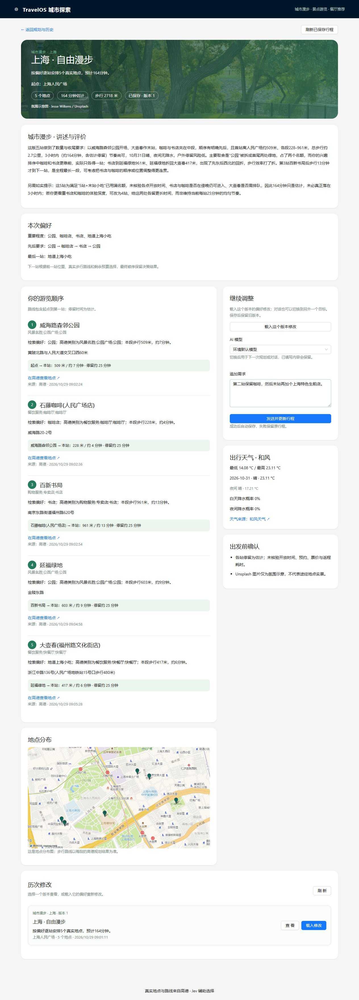

# TravelOS 城市探索助手

TravelOS 是一个基于多 Agent 的城市探索项目：从真实地点出发，规划城市漫步、查找景点或推荐餐厅。可以用表单指定偏好，也可以在已有行程上用自然语言提出修改，并查看历史版本。

## 功能展示

| 功能 | 能做什么 | 界面 |
| --- | --- | --- |
| 城市漫步 | 按兴趣、游览顺序、时间与步行距离规划路线，展示步行路段、天气和停留建议。 | [规划表单](docs/images/portfolio/01-citywalk-form.jpg) · [漫步结果与修改输入](docs/images/portfolio/07-citywalk-result-before.jpg) |
| 景点游览 | 结合起点和兴趣查找附近的景点，查看推荐理由及地图。 | [规划表单](docs/images/portfolio/02-attractions-form.jpg) · [景点结果](docs/images/portfolio/05-attractions-result.jpg) |
| 餐厅推荐 | 按餐食、菜系和距离寻找餐厅，查看推荐理由与地点分布。 | [规划表单](docs/images/portfolio/03-food-form.jpg) · [餐厅结果](docs/images/portfolio/06-food-result.jpg) |
| 对话规划和行程调整 | 使用自然语言表达目标，续接已有计划、保留指定地点，并查看历史版本。 | [对话入口](docs/images/portfolio/04-conversation-form.jpg) · [自然语言修改后的结果](docs/images/portfolio/08-citywalk-natural-language-update.jpg) |



图片展示真实界面与示例结果。地点、路线和地图由高德提供；封面是 Unsplash 氛围图，摄影师署名显示在页面内。调用外部服务时，结果可能因地点、日期、额度和服务可用性而变化。

## 运行环境

- Python 3.10 或以上，Node.js 20 或以上，以及 npm。
- 高德 Web 服务 Key：`AMAP_API_KEY`，用于地点、路线及地图。
- Unsplash Access Key：`UNSPLASH_ACCESS_KEY`，用于封面图片。
- OpenRouter API Key：`OPENROUTER_API_KEY`，用于 Jev 辅助判断。
- 至少一个生成模型 Key：例如 `DEEPSEEK_API_KEY`，用于理解需求和生成说明。
- 可选：和风天气的 `QWEATHER_API_HOST` 和 `QWEATHER_API_KEY`（或 `QWEATHER_JWT`）；未配置时天气会降级。

服务使用环境变量或本地 `backend/.env` 读取配置。复制模板后填写自己的密钥：

```bash
cd backend
cp .env.example .env
# 编辑 .env，填写上述密钥
```

Windows PowerShell 可使用 `Copy-Item .env.example .env`。`.env` 含私有密钥，已被 Git 忽略；前端无需填写地图密钥。

## 本地启动

在两个终端中分别运行后端和前端。

**后端：**

```bash
cd backend
python -m venv .venv
# macOS / Linux
source .venv/bin/activate
# Windows PowerShell 使用 .\.venv\Scripts\Activate.ps1
python -m pip install -r requirements.txt
python run.py
```

**前端：**

```bash
cd frontend
npm ci
npm run dev
```

在浏览器打开 <http://localhost:5173>。后端接口文档位于 <http://localhost:8000/docs>。如果后端使用其他地址，可复制 `frontend/.env.example` 为 `frontend/.env` 并设置 `VITE_API_BASE_URL`，然后重启前端。

## 使用流程

1. 选择“城市漫步”“景点游览”“餐厅推荐”或“对话规划”。
2. 输入城市和出发地点，搜索并选择正确的地点；按需要填写数量、偏好、时长等条件，点击“开始规划”。
3. 查看结果里的地点、推荐理由、地图及可用的路线和天气信息。城市漫步的新计划将步行时长与停留建议分开展示。
4. 在结果页的“继续调整”输入自然语言，例如“第二站保留石藤咖啡(人民广场店)，末站再加一个上海特色生煎店”，点击“发送并更新行程”。保留地点时建议写出当前计划里的完整名称。
5. 修改成功后生成新版本；可以在“历次修改”里查看旧版本，或载入某个版本继续调整。规划历史保存在本机数据库，默认有效期为 30 天。

如果地点不足或外部服务限流，页面会显示可用结果及原因；需要时可调整条件或稍后重试。

## 项目结构

```text
backend/app/agents/        主 Agent、三个规划 Agent 与讲述 Agent
backend/app/controllers/   API 接口
backend/app/services/      检索、路线、偏好及行程服务
backend/app/integrations/  高德、天气、模型与图片服务
backend/app/models/        请求、响应及行程存储模型
backend/tests/             后端测试
frontend/src/              Vue 页面、组件与 API 调用
docs/                      接口、设计说明与功能截图
```

后端接口与字段说明见 [API 文档](docs/TRAVELOS_API.md)，项目结构见 [目录导航](docs/PROJECT_STRUCTURE.md)。
