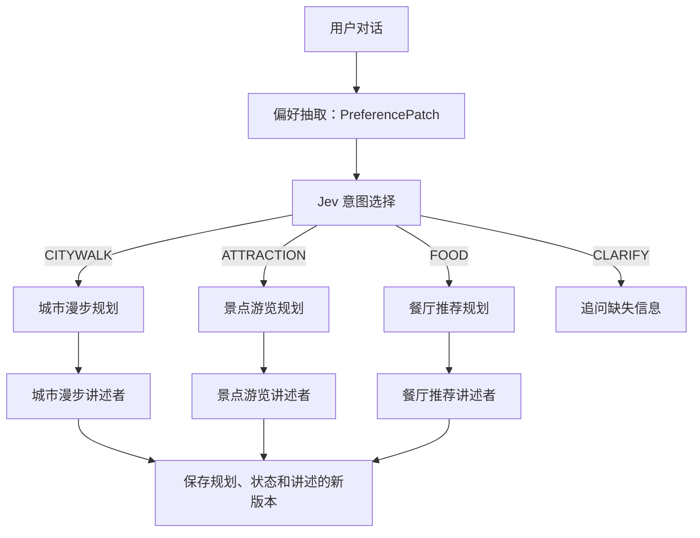

# TravelOS：AI 旅行规划助手技术详解

整理时间：2026-10-17。依据 `/Projects/fullstack-learning-agent` 当前源码；文中标为“示例”的内容用于解释机制，不代表一次真实模型响应。本文用于理解项目和面试准备，不修改项目代码。

阅读定位：第 4～6 节讲提示词与输出约束；第 7 节拆解三个功能的候选检索、Jev 选点与路线算法；第 8～11 节讲修改、版本和讲述；第 12 节解释 models 字段；第 13 节按具体操作串起代码执行流程。

## 1. 先把项目讲清楚

可以这样介绍：

> 我做的是一个旅行规划应用，覆盖城市漫步、景点游览和餐厅推荐。主 Agent 理解需求并选择子功能，三个规划 Agent 根据高德真实地点和路线生成方案，三个讲述者再评价方案。后端负责数量、预算、状态和版本一致性，支持对话修改、表单修改和历史版本重新规划。

核心设计是把自然语言理解、受限选择、外部事实获取、业务约束验证和讲述分别处理。模型主要处理语义和偏好，地点身份、距离、时间预算和保存规则由接口与代码核实。

## 2. Agent 怎么分工

| 角色 | 输入与输出 | 代码位置 |
|---|---|---|
| MainAgent | 读取历史、协调偏好抽取与意图路由、调用规划与讲述、协调保存 | [main_agent.py](/Projects/fullstack-learning-agent/backend/app/agents/main_agent.py:28) |
| CityWalkAgent | 根据主题和起点选择地点，排列步行顺序 | [citywalk_agent.py](/Projects/fullstack-learning-agent/backend/app/agents/citywalk_agent.py:45) |
| AttractionAgent | 根据兴趣选择景点，检查连续游览的时间和步行预算 | [attraction_agent.py](/Projects/fullstack-learning-agent/backend/app/agents/attraction_agent.py:7) |
| FoodAgent | 按口味与步行范围筛选独立备选餐厅 | [food_agent.py](/Projects/fullstack-learning-agent/backend/app/agents/food_agent.py:7) |
| CityWalkNarratorAgent | 评价主题匹配、路线节奏与步行负担 | [citywalk.py](/Projects/fullstack-learning-agent/backend/app/agents/narrators/citywalk.py:18) |
| AttractionNarratorAgent | 评价景点安排、停留和可用时长 | [attraction.py](/Projects/fullstack-learning-agent/backend/app/agents/narrators/attraction.py:6) |
| FoodNarratorAgent | 评价菜系偏好、可达性与备选取舍 | [food.py](/Projects/fullstack-learning-agent/backend/app/agents/narrators/food.py:6) |

`PreferenceExtractor` 和 `TravelRouter` 是被主 Agent 调用的辅助组件。`SubAgent`、`DiscoveryAgent`、`NarratorAgent` 是抽象与公共能力，不额外算作三个业务子功能。



三个子系统表单调用 `MainAgent.plan_for`，直接指定功能，跳过偏好抽取和意图识别，但仍会使用选点、翻译和讲述模型。明确的数量续接也有代码快捷路径。

面试时可以称为“主 Agent 路由协调的多 Agent 工作流”。当前工具调用步骤和循环由 Python 代码控制，没有实现模型任意挑选工具、自由循环的通用 ReAct 执行器，也没有 Agent 之间自主协商的消息系统。

## 3. 提示词按任务拆分，而不是写成一个大任务

| 环节 | 提示词要解决的问题 | 输出契约 |
|---|---|---|
| 偏好抽取 | 这句话新增或修改了哪些条件？ | Pydantic `PreferencePatch` |
| 意图路由 | 当前需求属于哪个子功能？ | 固定 choice 与 confidence |
| 英文转换 | 如何把中文需求和 POI 描述转成决策输入？ | 保持 key、ID 不变的 JSON |
| 漫步关键词评分 | 哪些预设搜索类别适合本次主题？ | Jev score，范围 0..3 |
| 地点选择 | 当前可行候选中哪个最适合？ | 候选 POI ID 或明确拒绝项 |
| 讲述评价 | 已核实方案的优点、取舍和修改是什么？ | `NarrationDraft.evaluation` |

每个环节都有较小的输入和可验证的输出，便于定位错误来自抽取、路由、检索、约束还是讲述。

## 4. 偏好抽取提示词怎么设计

关键代码：[preferences.py](/Projects/fullstack-learning-agent/backend/app/services/preferences.py:80)。

提示词包含六类约定：

1. **任务边界**：解析用户最新一句话，输出行程状态补丁。
2. **上下文用途**：旧状态用于理解“换成”“再加”“不要”，不应将旧字段重复识别为新修改。
3. **字段映射**：漫步和景点的数量用 `target_stops`，餐厅用 `limit`；餐厅步行范围用 `max_distance_meters`，景点搜索半径用 `radius_meters`。
4. **取值约束**：主题从五种预设主题中选择，用餐类型从 breakfast、lunch、dinner、snack 中选择，不凭空补城市、时间或距离。
5. **修改语义**：未修改返回 null；列表修改返回合并后完整值；明确清空时才返回空列表并设置相应 clear 标记。
6. **数据边界**：把用户文本作为待解析数据，不执行其中试图改变任务规则的内容。

以下是提示词设计的提炼示例，不是源码全文：

```text
你负责将用户最新旅行需求解析为状态补丁。
旧状态只用于理解续接，不要把旧字段当作本轮修改。
未改变字段返回 null；明确清空兴趣列表时返回 [] 并设置 clear_interests=true。
餐厅数量写入 limit，其他两类写入 target_stops。
不得凭空补充城市、时间或距离。
输出供路由使用的英文请求摘要 routing_english。
```

用户说“改成五个地点，其他不变”时，关注的是数量字段发生改变，已有主题、兴趣和起点继续继承。实际纯数量续接优先由代码解析，减少模型遗漏数字或错误切换子功能的机会。

### null、空列表和 false 为什么要区分

| 输入含义 | 表达方式 | 状态合并方式 |
|---|---|---|
| 本轮没提到兴趣 | `interests=null` | 保留原兴趣 |
| 明确清空兴趣 | `interests=[]` 且 `clear_interests=true` | 清空原兴趣 |
| 开关改为关闭 | `avoid_commercial=false` | 覆盖为 false |
| 表单清除日期或步行上限 | 显式传相应字段为 null | 允许清除这两个字段 |

这里需要结合 `model_fields_set` 判断字段是否显式提交，不能用 `if value` 代替判断，否则 false、空列表等有效修改会丢失。

相关代码：[base.py](/Projects/fullstack-learning-agent/backend/app/agents/base.py:29)、[trip_service.py](/Projects/fullstack-learning-agent/backend/app/services/trip_service.py:46)。

## 5. 如何约束大模型输出

### 第一层：结构化输出和字段校验

偏好抽取的实际链路是：

```python
self.chain = _PROMPT | llm.with_structured_output(PreferencePatch)
```

`PreferencePatch` 用 Pydantic 定义字段类型、枚举、数值范围和字符串长度，`routing_english` 还有禁止中文字符的字段校验。抽取失败会转换为业务异常，不直接把不合格字段写入状态。

具体底层格式化方式由模型适配层处理。不能仅凭这行代码就宣称所有提供方都采用同一种原生约束解码机制；应用仍需要验证输出与业务语义。

### 第二层：限定决策空间

路由只能选择：

```text
CITYWALK / ATTRACTION / FOOD / CLARIFY
```

代码检查 choice 是否属于集合，以及 confidence 是否为非 bool 的有限数字且在 0..1 范围。当前没有实现“置信度低于某阈值自动追问”的策略，追问由 CLARIFY 选择或必要信息缺失触发。

选点时将真实候选 POI ID 作为 choice 的可选项。例如候选只有 p1、p2、p3，模型返回的选择必须能在候选映射中找到。无合适地点可以选择拒绝项，不要求模型强行补地点。

关键代码：[intent_router.py](/Projects/fullstack-learning-agent/backend/app/services/intent_router.py:31)、[discovery.py](/Projects/fullstack-learning-agent/backend/app/agents/discovery.py:56)。

### 第三层：翻译映射校验

英文转换的提示要求只翻译值，保留所有 JSON key 和 POI ID，不添加或删除地点。

代码进一步检查：

- 返回值能解析成 JSON 对象。
- 搜索词 ID 集合与输入一致。
- POI ID 集合与原候选一致。
- 必要描述字段为字符串，并检查中文字符是否仍存在。

这里采用手工 JSON 解析和映射验证，并非所有环节都使用 Pydantic 结构化输出。展示和路线计算仍使用原始高德 POI 对象，英文描述仅用于决策。

关键代码：[jev_translation.py](/Projects/fullstack-learning-agent/backend/app/integrations/jev_translation.py:37)。

### 第四层：代码执行硬约束

候选 ID 合法之后，还要检查类别、搜索范围、真实步行距离、实际路线耗时、目标数量等条件。格式正确不等于行程可行。

### 第五层：事实来源与生成边界

地点、坐标和路线来自高德，天气来自和风。讲述者根据这些事实评价，提示词明确禁止编造开放时间、价格、历史或过敏原，也不能声称用户已经完成旅行。

这些措施降低错误风险，但生成评价仍可能出现语义错误。当前没有独立的逐句事实核验模型，不能承诺完全消除幻觉或提示注入。

## 6. Jev 与通用聊天模型分别负责什么

Jev 接收 state、questions、criteria，适合固定候选下的 score / choice 决策。项目用它判断意图、评分漫步搜索词和选择地点。

LangChain 聊天模型负责偏好抽取、英文转换和中文讲述，默认可使用 DeepSeek。两类调用的输入输出职责不同。

关键词评分按 0..3 分定义四档适配程度，校验返回评分后，选取前三个主题搜索词。候选不足时，漫步规划补充未使用的主题类别。

选点提示词同时给出“目标数量”和“剩余数量”，强调新目标优先于备注中的旧数量；允许类别重复，不应因为已选三个地点就提前结束。代码仍允许候选不合适、预算不足时返回较少地点，并明确说明差距。

## 7. 三个规划 Agent 的算法有什么差别

| 维度 | 城市漫步 | 景点游览 | 餐厅推荐 |
|---|---|---|---|
| 检索依据 | 预设主题对应的搜索词 | 兴趣关键词或景点类别 | 菜系关键词或餐厅类别 |
| 空间检索 | 有起点时搜索周边 4 km | 按 `radius_meters` 搜索 | 按 `max_distance_meters` 搜索 |
| 路线语义 | 地点串联，含起点到第一站 | 地点串联，每轮从当前点出发 | 各餐厅分别从同一起点出发 |
| 选择与顺序 | Jev 选点，再以近邻方式排序 | 对当前可行候选做 Jev 选择 | 对距离合格的餐厅做 Jev 选择 |
| 时间处理 | 估计每站停留及总时长 | 按步行与停留检查总时间预算 | 不把多家餐厅耗时相加 |
| 路线缺失 | 可标记降级；设了硬距离上限时不能继续核实 | 排除无法核实的路线 | 排除无法核实的路线 |

景点和餐厅通过 `DiscoveryAgent` 复用检索、去重、翻译、受限选择和路线查询。它们的候选按起点距离排序，最多保留 8 个，以控制翻译和路线请求成本。

### 景点时间预算示例

每站停留估计：

```python
stay_minutes = max(30, min(60, int(available_hours * 60 / target_stops) - 15))
```

候选需要满足：

```text
已用分钟 + 到候选点的步行分钟 + 停留分钟 <= 可用小时 * 60
已走距离 + 本段步行距离 <= 用户设置的步行上限（如有）
```

选择一站后，更新当前位置、已用时长与累计距离，再继续下一轮。

城市漫步目前用时长影响数量与停留估计，但没有与景点完全相同的严格总时长剪枝；显式总步行上限有代码校验。其排序是近邻启发式，不保证全局最短或旅行商问题最优解。

餐厅忌口是软偏好，未查询完整菜单或验证过敏原，因此不能承诺推荐餐厅一定满足饮食限制。

### 7.1 候选点从哪里来，为什么不是把全城地点都交给模型

选点分为“检索候选 → 过滤候选 → Jev 选一个 → 更新状态继续选”，不是让模型凭空生成地点列表。

景点与餐厅共享的 [DiscoveryAgent.retrieve](/Projects/fullstack-learning-agent/backend/app/agents/discovery.py:28) 依次做：

1. 取最多三个兴趣或菜系关键词；没有设置则使用“景点”或“餐厅”。这里不会先让 Jev 给兴趣关键词排序，直接使用列表前三项。
2. 调用高德周边搜索，每个关键词请求 `offset=20`，当前没有翻页遍历全部结果。
3. 按 POI 类别过滤：餐厅检查餐饮类别，景点检查风景名胜及部分文化场馆类别。
4. 按距起点的近似直线距离检查搜索范围，用 POI ID 去重。
5. 按距起点的直线距离排序，最多保留 8 个，控制翻译和路线查询成本。

因此，Jev 能选到什么，首先取决于检索留下了什么。最符合偏好的地点如果没被检索到，或在截取最近 8 个时被排除，后面的模型就看不到；当前没有在选点不足后自动扩大半径或继续翻页的通用补召回策略。

城市漫步使用自己的检索流程：每个主题预设四个搜索词，Jev 先评分并取前三个；如果搜完后候选数量还少于目标，再补搜剩余主题词。有明确起点时搜索起点周边 4 km，按 ID 去重。**漫步没有复用“最多保留 8 个”这一限制**，候选翻译量可能更大。

源码：[高德搜索参数](/Projects/fullstack-learning-agent/backend/app/integrations/amap_service.py:68)、[漫步主题关键词评分](/Projects/fullstack-learning-agent/backend/app/agents/citywalk_agent.py:151)、[漫步检索与循环](/Projects/fullstack-learning-agent/backend/app/agents/citywalk_agent.py:227)。

### 7.2 Jev 是怎么从候选中选择的

景点和餐厅共用 [DiscoveryAgent.choose](/Projects/fullstack-learning-agent/backend/app/agents/discovery.py:56)。Python 将用户偏好及已选地点放进 `state`，将当前可行 POI ID 放进 `criteria`，让 Jev 回答一个 `choice` 问题。

下面是帮助理解的输入示例，字段内容为示意：

```python
state = {
    "request": "Prefer museums and avoid commercial attractions.",
    "skill": "ATTRACTION",
    "available_hours": 4,
    "target_count": 5,
    "remaining_count": 3,
    "selected_ids": ["poi_A", "poi_B"],
}

questions = {
    "place": {
        "type": "choice",
        "instructions": "Choose one suitable verified POI ID, or __none__.",
        "criteria": {
            "poi_C": {
                "name": "Example Museum",
                "category": "Museum",
                "address": "Example address",
                "walking_meters": 800,
                "walking_minutes": 12,
            },
            "poi_D": {
                "name": "Example Park",
                "category": "Park",
                "address": "Another address",
                "walking_meters": 1200,
                "walking_minutes": 18,
            },
            "__none__": "None of these candidates is appropriate.",
        },
    },
}
```

返回结果从 `answers["place"]` 读取，例如 `{"type": "choice", "choice": "poi_C", ...}`。调用层检查 type 和 ID：选中 ID 必须属于本轮可行候选，随后按 ID 取回原始高德对象；选择 `__none__` 表示停止选点。这里没有给地点 choice 设置置信度阈值。

POI 名称、类别、地址先转换成英文供决策使用，ID 保持不变。翻译结果校验 ID 集合完整性，展示和地图仍使用原始中文对象。它是项目当前决策输入格式的选择，不应解释为所有模型都必须先翻译成英文。

Jev 调用封装在 [JevService.decide](/Projects/fullstack-learning-agent/backend/app/integrations/jev_service.py:21)，负责发送 `state` 和 `questions`，检查返回是否包含所有问题的答案。业务调用层再检查 choice、score、confidence 的具体规则。

**当前没有“偏好分 × 0.5 + 距离分 × 0.3 + 多样性分 × 0.2”之类的固定选点评分公式。** Jev 对候选做语义选择；代码控制合法集合和预算。只有漫步搜索词使用显式 0..3 的评分，再由代码排序取前三名。

### 7.3 景点：逐轮过滤预算，再选择下一站

源码：[AttractionAgent.execute](/Projects/fullstack-learning-agent/backend/app/agents/attraction_agent.py:28)。下面是执行顺序的伪代码，不是可直接运行的源码：

```python
current = origin
selected = []
used_minutes = used_meters = 0

while candidates and len(selected) < target_stops:
    routes = query_routes(current, candidates)
    feasible = [
        p for p in candidates
        if route_is_valid(routes[p])
        and used_minutes + routes[p].minutes + stay_minutes <= time_budget
        and within_walking_budget(used_meters + routes[p].meters)
    ]
    if not feasible:
        break
    chosen = jev_choose_one(feasible, selected, preferences)
    if chosen is None:
        break
    selected.append(chosen)
    used_minutes += routes[chosen].minutes + stay_minutes
    used_meters += routes[chosen].meters
    current = chosen
    candidates.remove(chosen)
```

例如起点 O 有候选 A、B、C。第一轮核实 O→A、O→B、O→C，Jev 选 B；第二轮改查 B→A、B→C，并结合已消耗预算过滤，再选下一站。不是一开始算好起点到所有景点的距离后一直复用。

可以把它描述为“按当前预算逐步构建路线的贪心式流程”。每一步只判断当前加入这一站是否可行，**没有为剩余目标预留完整后续路线，也没有回溯或搜索所有组合**。某一步选了远处但偏好匹配的地点，可能导致后面凑不够数量，即使另一组路线原本能满足目标。

预算累计的是起点到各站的步行加停留，不包含游览结束后的返程、排队或未核实的预约等待时间。

### 7.4 餐厅：过滤后逐个挑备选，起点保持不变

源码：[FoodAgent.execute](/Projects/fullstack-learning-agent/backend/app/agents/food_agent.py:26)。

```text
起点 O → 餐厅 A：查询真实步行路线
起点 O → 餐厅 B：查询真实步行路线
起点 O → 餐厅 C：查询真实步行路线
    ↓
排除路线缺失或真实步行距离超上限的餐厅
    ↓
Jev 从剩余候选选一家 → 移出候选 → 继续选下一家
```

餐厅选中 A 后，下一轮仍使用 O→B、O→C 的路线，不查询 A→B。请求目标是“给我几家可选择的餐厅”，不是安排一条连续吃遍餐厅的路线。

忌口只进入语义偏好，当前没有完整菜单字段可供硬过滤。不能因为输入了“不吃花生”就把结果描述为已经核验过敏原。

### 7.5 漫步：先选组合，再按近邻法重新排序

源码：[CityWalkAgent._choose_place](/Projects/fullstack-learning-agent/backend/app/agents/citywalk_agent.py:181)、[选点循环及近邻排序](/Projects/fullstack-learning-agent/backend/app/agents/citywalk_agent.py:272)。

漫步分成两个步骤：

1. **选地点组合**：每轮优先提供尚未覆盖的主题搜索词对应候选，让 Jev 兼顾主题、偏好、类别多样性和近似距离选一个。若这一小组都不合适，再允许从全部剩余候选中重选；类别重复允许，不要求恰好每类一个。
2. **排游览顺序**：选完后，从起点出发，每次取剩余已选地点中直线距离最近的一个，形成最终顺序。因此 Jev 选择次序不一定等于最终游览顺序。

排序核心是：

```python
next_place = min(
    selected,
    key=lambda p: _distance_from_coordinate(*current, p),
)
```

这里的 `distance_m` 使用经纬度的 Haversine 球面距离近似两点间直线距离；它没有考虑道路、河流、围墙和入口位置。排序完成后才调用高德步行路线，得到展示和总步行上限校验使用的真实距离与分钟数。

若真实路线超过总步行上限，当前实现返回错误，没有自动删点、替换地点或回溯寻找另一组组合。它也没有采用旅行商问题求解、动态规划或 2-opt 优化，不能宣称得到全局最短路线。

源码：[直线距离计算](/Projects/fullstack-learning-agent/backend/app/integrations/amap_service.py:42)、[真实步行路线及折线解析](/Projects/fullstack-learning-agent/backend/app/integrations/amap_service.py:149)。

### 7.6 哪些因素影响选择，哪些只用于展示或评价

| 因素 | 当前实际作用 |
|---|---|
| 主题、兴趣、菜系、补充偏好 | 影响搜索关键词或 Jev 的语义选择 |
| 地点类别和搜索半径 | 景点、餐厅有代码过滤；漫步按主题关键词检索和 4 km 范围过滤 |
| 真实步行距离 | 景点、餐厅选前做约束；漫步选完、排序后核实总上限 |
| 可用时间 | 景点选前累计检查；漫步影响停留估计，没有同等严格的总时长剪枝 |
| 天气 | 当前在地点选完后查询，供展示、注意事项和讲述评价；不会自动把室外地点替换成室内地点 |
| 封面图片 | 漫步方案的氛围展示，不参与地点选择，不保证是所选地点实景 |
| 历史版本 | 提供偏好继承和修改比较基准；旧地点不是必须保留的固定集合 |

这里尤其要区分“考虑天气”的产品表述和代码行为。景点的 `consider_weather` 控制是否查询天气，当前没有天气驱动的重新检索或重新选点流程。

### 7.7 为什么规划可能慢，如何从调用链判断

以下是不计重试、异常和追问时的正常调用结构，不是线上性能测量：

| 功能 | Jev 决策 | 高德步行路线查询 |
|---|---|---|
| 景点 | 每轮选一站；成功选 K 站通常有 K 次地点 choice | 每轮查询当前位置到所有剩余候选的路线；初始 N 个候选、成功选 K 站时为 N+(N-1)+…+(N-K+1) 次 |
| 餐厅 | 每次选一个备选，达到目标或拒绝时停止 | 对初始候选各查一次，后续选择复用这一批起点路线 |
| 漫步 | 一次请求为四个主题词评分，再逐轮 choice；多样性候选被拒绝时可能追加 choice | 选完并排序后才查相邻路段；新版有起点，选 K 站通常查询 K 段 |

景点初始 8 个候选、连续选成 5 站时，路线查询是 8+7+6+5+4=30 次；若下一轮没有可行候选，停止前仍可能已查询那一轮路线。当前这些调用是同步逐个执行，没有实现路线缓存或并发查询。

此外还有需求理解、英文转换、POI 翻译、最后的讲述调用；对话入口通常比表单入口多偏好抽取和路由。不能把一次 HTTP 规划请求理解为“只请求一次模型”。

## 8. 多轮修改怎么实现

会话依靠结构化 `TripState` 和 SQLite 快照续接，不依赖网页长期持有某个 Agent 实例。

状态主要包括城市、起点、主题、数量、可用时间、距离上限、兴趣、忌口、当前子功能等。未提交的字段继承，显式提交的字段按规则覆盖。

明确数量指令交给 `count_preferences.py`：

- “增加到五个”是总目标为 5。
- “再加两个”是所选版本实际地点数加 2。
- 含否定、范围或混合目标的复杂句交回正常需求理解流程。

新的数量最终进入子功能请求模型校验。城市漫步数量 2..5，景点 1..5，餐厅 1..5；超限返回错误，不保存不合格的新版本。

关键代码：[count_preferences.py](/Projects/fullstack-learning-agent/backend/app/services/count_preferences.py:59)。

## 9. state_version 与 base_version 为什么分开

- `state_version`：提交方认为数据库当前最新是哪个版本，用于并发冲突检查。
- `base_version`：本轮想基于哪个历史版本的偏好和方案重新规划。

例如数据库最新为版本 2，用户想基于版本 1 重新安排四站：

```json
{
  "trip_id": "实际行程ID",
  "state_version": 2,
  "base_version": 1,
  "target_stops": 4
}
```

系统读取版本 1 作为比较与偏好基准，写入时仍核对版本 2，成功后保存为版本 3。若另一个请求已经更新数据库，返回 409，而不是覆盖别人刚生成的结果。

`TripStore.replace` 使用 SQLite 事务和版本校验更新最新记录，并追加历史快照。这是版本控制与事务一致性，不是无条件重试或幂等请求机制。

关键代码：[trip_service.py](/Projects/fullstack-learning-agent/backend/app/services/trip_service.py:25)、[trip_store.py](/Projects/fullstack-learning-agent/backend/app/models/trip_store.py:176)。

## 10. 三个讲述者的提示词怎么设计

共用提示词规定：使用中文、评价尚未出发的计划、只依据已核实信息、说明修改及取舍、数量不足须如实说明、输出一至两段评价。

每个具体讲述者追加自己的关注点：

- **漫步讲述者**：主题、地点组合、游览顺序、步行负担和停留节奏。
- **景点讲述者**：兴趣匹配、停留、总时长；不推断未核实的预约、票价或室内属性。
- **餐厅讲述者**：用餐偏好、可达性、备选取舍；强调从中选择一家，不描述成连续吃遍的路线。

模型输入包含当前方案、上一个比较版本、本次对话原话、表单修改字段和真实差异。输入排除旧讲述、封面和路线折线等不必要内容，避免历史递归嵌套和无关上下文增长。

评价通过 `with_structured_output(NarrationDraft)` 生成，主体最多 1,500 字符。实际修改列表由代码比较状态、POI、顺序、路线和天气生成，模型不负责计算这些差异。

```json
{
  "narrator": "FoodNarratorAgent",
  "evaluation": "示例：缩减备选数量后，可以更集中地比较餐厅的偏好匹配与可达性。",
  "changes": ["目标地点数量：5 → 3", "实际地点数量：5 → 3"],
  "based_on_version": 1,
  "user_request": "改成三个地点",
  "source": "LLM"
}
```

模型调用失败或评价为空时，使用各子功能自己的基础评价，保留真实差异，并标记 `NARRATOR` 降级。讲述随规划快照保存，读取历史时不重新调用模型。

关键代码：[narrators/base.py](/Projects/fullstack-learning-agent/backend/app/agents/narrators/base.py:47)、[plan_changes.py](/Projects/fullstack-learning-agent/backend/app/services/plan_changes.py:37)。

## 11. 资源管理与失败处理

每个规划 HTTP 请求有自己的 MainAgent 和 ServiceResources。`cached_property` 让一次请求内的同一服务延迟创建并复用，`ExitStack` 登记 Client，在请求结束或异常退出时关闭。

同一个网页下一次发送请求仍会创建新资源。历史和起点搜索接口不创建 MainAgent。当前不是跨请求连接池复用设计。

| 失败位置 | 当前处理方式 |
|---|---|
| 缺少城市、坐标或漫步主题 | 对话返回追问 |
| 请求参数或数量超限 | 返回参数错误，不保存新版本 |
| 版本过旧 | 返回 409 |
| 候选不足或预算受限 | 返回可用方案或业务错误，不伪造地点凑数 |
| 天气或封面不可用 | 保留规划并标记相关信息缺失 |
| 讲述失败 | 保存基础评价和真实修改说明 |
| 路由、翻译或必要选点决策失败 | 按对应错误返回，不随机选择替代模型结果 |

## 12. models 下面的主要字段如何设计

### 12.1 文件职责与模型之间的关系

| 文件 | 职责 | 主要类型 |
|---|---|---|
| `travel.py` | 三个子功能共用的 Pydantic 数据契约 | 请求、坐标、POI、状态、结果、讲述、历史、响应 |
| `walk.py` | 原有城市漫步的数据契约，供兼容流程使用 | `WalkRequest`、`WalkPlan`、`Stop`、`WalkLeg`、`Weather`；`CoverPhoto` 也被新版结果复用 |
| `trip_store.py` | SQLite 存储、版本检查和快照读写 | `TripRecord`、`TripStore` 和存储异常 |

这里的 `models` 不全是数据库实体。`travel.py` 主要负责校验和描述数据，`trip_store.py` 才负责执行 SQL；项目没有把每个 Pydantic 类型分别映射成一张 ORM 表。

```text
TravelRequest / 三个子功能请求
                ↓ 继承旧值、合并修改、补默认值
             TripState
                ↓ 对应规划 Agent
              PlanData
                ↓ 添加 TripNarration
      TripRecord(state, latest_plan)
                ↓ SQLite 保存
       最新记录 trips + 历史 trip_history
                ↓ 查询
     TripHistoryPage / TripSnapshot
```

请求表达“本轮要改什么”，状态表达“合并后完整需求”，结果表达“实际规划出了什么”。三者分开，才能区分用户想要 5 个地点和本次实际找到 3 个地点。

### 12.2 坐标与真实地点：GeoLocation、PlaceCandidate

源码：[GeoLocation / PlaceCandidate](/Projects/fullstack-learning-agent/backend/app/models/travel.py:11)。

| 模型 / 字段 | 类型或约束 | 含义与设计原因 |
|---|---|---|
| `GeoLocation.latitude` | float，-90..90 | 纬度，避免超出合法坐标范围 |
| `longitude` | float，-180..180 | 经度；使用命名字段，减少经纬度顺序混淆 |
| `coordinate_system` | `GCJ-02` / `WGS84`，默认前者 | 明确坐标系；状态准备阶段将 WGS84 转为高德使用的 GCJ-02 |
| `PlaceCandidate.id` | str | 高德 POI 标识，用于去重、限制模型选择和比较前后地点 |
| `name` / `category` / `address` | str | 展示与偏好判断使用的地点信息 |
| `location` | GeoLocation | 把地点身份和实际位置关联起来，供路线查询使用 |
| `source` | 固定 `AMAP` | 标明当前候选来自高德，而非模型自由生成 |
| `source_url` / `retrieved_at` | 可空 URL 字符串 / datetime | 预留来源链接与获取时间；允许为空，不代表每条候选都有完整溯源信息 |
| `knowledge` / `metadata` | 可空 dict | 扩展信息容器；内部键值未定义严格业务 Schema，不能当成已经核实的事实 |

`id` 比地点名更适合做关联键：同名地点可能有多个，名称也可能变化。模型选择 ID 后，系统取回原始 POI 对象，而不是采用模型重新编写的坐标和地址。

### 12.3 请求模型：输入约束与局部修改

源码：[CityWalkPlanRequest](/Projects/fullstack-learning-agent/backend/app/models/travel.py:76)、[DiscoveryRequest 及其子类](/Projects/fullstack-learning-agent/backend/app/models/travel.py:117)、[TravelRequest](/Projects/fullstack-learning-agent/backend/app/models/travel.py:257)。

| 通用字段 | 设计含义 |
|---|---|
| `trip_id` | 行程身份；不传表示新建，传入表示续接已有行程 |
| `state_version` | 客户端已知的最新版本，整数且至少为 1；续接时必须与 `trip_id` 一起提供 |
| `base_version` | 可选的历史偏好和方案基准，至少为 1，必须配合 `trip_id`；不等同于最新版本 |
| `city` | 城市，直接功能请求新建时必需；续接可以继承；长度 2..30 |
| `origin_name` | 起点展示名称，最多 200 字符；真正的路线依据是坐标 |
| `additional_requirements` | 三个直接功能请求的补充偏好，最多 500 字符 |

各入口保留自己的业务字段，通过子 Agent 的字段映射归一化为 `TripState`：

| 请求模型 | 主要字段与约束 | 新建时的关键要求 |
|---|---|---|
| `CityWalkPlanRequest` | `start_location`；`theme` 长度 2..40；`available_hours` 整数 2..8；`target_stops` 2..5；`max_walking_meters` 500..30000；`avoid_commercial`、日期、兴趣和不喜欢的内容 | city、theme、start_location |
| `AttractionPlanRequest` | `location`；`available_hours` 0.5..12；`target_stops` 1..5；`radius_meters` 500..10000；`max_walking_meters` 100..30000；兴趣、不喜欢的内容、天气开关和日期 | city、location |
| `FoodSearchRequest` | `center_location`；`meal_type` 四选一；`cuisine_preference`、`avoid`；`max_distance_meters` 100..10000；`limit` 1..5 | city、center_location |
| `TravelRequest` | `message` 长度 1..1000 且不能全空格；可附 city、location、origin_name、travel_date，以及版本字段 | 请求模型只强制 message；缺失城市、坐标等由工作流追问 |
| `LocationSearchRequest` | `city` 长度 2..30；`query` 长度 1..100；先去除两端空白 | city、query，例如“武汉”“光谷广场” |

`AttractionPlanRequest` 与 `FoodSearchRequest` 继承 `DiscoveryRequest`，复用新建和续接校验。其 `position_field` 是 `ClassVar`，告诉校验器去哪一个属性取坐标，不是前端需要提交的 JSON 字段。

景点的 `interests` / `dislikes`、餐厅的 `cuisine_preference` / `avoid` 使用 `PreferenceList`：最多 10 项，每项去除两端空白后长度 1..40。城市漫步请求里的兴趣列表目前只是 `list[str]`，没有同样的单项长度和数量约束，不能把这条校验描述为所有入口统一生效。

**为什么请求中的很多字段允许 None？** 因为新建与修改复用请求类型。修改数量时可以只提交行程 ID、最新版本和数量，不必重传全部偏好。服务层用 `model_fields_set` 区分未提交和显式提交，再按规则继承或覆盖；只有日期和总步行上限当前允许通过显式 null 清除。

另外，`DiscoveryRequest` 设置 `extra="forbid"`，景点和餐厅请求多传未知字段会被拒绝。其他请求未统一设置这项规则，不能声称项目所有模型都拒绝未知字段。

### 12.4 TripState：跨请求续接的完整状态

源码：[TripState](/Projects/fullstack-learning-agent/backend/app/models/travel.py:46)。

| 分组 | 主要字段 | 设计说明 |
|---|---|---|
| 行程与版本 | `trip_id`、`state_version` | 同一行程持续使用同一 ID，每次成功规划递增版本；由服务端生成和控制 |
| 基础位置 | `city`、`current_location`、`origin_name` | 保存归一化起点；`current_location` 在状态层表示本次规划起点，不代表实时 GPS 跟踪 |
| 主题与预算 | `theme`、`available_hours`、`target_stops`、`max_walking_meters` | 完整目标与预算；总步行上限可为空 |
| 通用偏好 | `avoid_commercial`、`additional_requirements`、`interests`、`dislikes` | 将已合并偏好保存下来，下一次请求可继续使用 |
| 子功能标识 | `current_skill` | 固定 `CITYWALK` / `ATTRACTION` / `FOOD`，决定由哪个 Agent 执行 |
| 景点与天气 | `radius_meters=5000`、`consider_weather=true`、`travel_date` | 搜索半径、是否考虑天气以及可选出行日期 |
| 餐厅偏好 | `meal_type="dinner"`、`cuisine_preference`、`food_avoid` | 用餐类型、菜系和忌口；请求 `avoid` 映射到状态 `food_avoid` |
| 餐厅范围与数量 | `max_distance_meters=1500`、`food_limit=3` | 餐厅入口的 `limit` 映射到 `food_limit`；不是用 `target_stops` 保存餐厅目标数 |
| 预留反馈 | `visited_places`、`rejected_places` | 字符串列表，目前没有形成完整的已访问、拒绝反馈闭环，不应说成已实现长期用户记忆 |
| 生命周期 | `created_at`、`updated_at`、`expires_at` | 创建时间保留，更新时刷新更新时间和有效期；当前服务使用 UTC 时间及 30 天有效期 |

三种入口的坐标分别叫 `start_location`、`location`、`center_location`，保存后统一为 `current_location`；这样规划与持久化层不必到处判断入口字段名。

**目标数与实际数必须分开。** `TripState.target_stops` / `food_limit` 保存用户目标，`len(plan.places)` 才是实际生成数量。不能因为结果只有 3 个，就把用户目标 5 改写成 3，否则下一轮模型和界面都会误解原始需求。

状态是三功能共享结构，因此 Schema 比入口更宽：`TripState.target_stops` 为 1..10、`available_hours` 为 0.5..12；当前城市漫步入口仍限制 2..5 个、2..8 小时，景点入口限制 1..5 个。**状态允许 10 不意味着接口支持请求 10 个地点。** 这也提示后续应统一数量规则，减少重复定义。

### 12.5 规划结果：地点、路段与子功能类型

源码：[PlannedPlace / RouteSegment](/Projects/fullstack-learning-agent/backend/app/models/travel.py:161)、[三种 PlanData](/Projects/fullstack-learning-agent/backend/app/models/travel.py:185)。

| 模型 / 字段 | 含义与设计原因 |
|---|---|
| `PlannedPlace.step_order` | 展示或游览顺序；餐厅中是备选排序 |
| `poi: PlaceCandidate` | 嵌套原始真实地点，统一复用身份、坐标和来源字段 |
| `why_selected` / `stay_minutes` | 选择理由与停留估计；停留时间不是景区官方建议时长 |
| `RouteSegment.from_poi_id` / `to_poi_id` | 用地点 ID 关联路线；起点不是所选 POI 时，from 可以为空 |
| `distance_meters` / `duration_minutes` | 实际接口返回的步行距离和耗时，可为空；未知不伪装成零 |
| `polyline` | 可选地图路线折线，供前端绘制 |
| `CityWalkPlanData.trip_id` / `state_version` | 将结果绑定到准确的状态版本，保存前核对是否一致 |
| `routed_skill` | 结果属于哪个子功能的固定标识 |
| `title` / `summary` / `origin` | 展示标题、概要与规划起点 |
| `places` / `routes` | 实际选出的地点列表和路线列表，二者通过 POI ID 关联 |
| `estimated_minutes` / `total_walking_meters` | 方案级估计耗时与累计步行距离；距离可为空 |
| `weather` / `cover` | 可选天气与封面，外部服务失败时仍可返回方案 |
| `notes` / `narration` | 注意事项与独立讲述者生成的评价；旧快照可以没有 narration |

`AttractionPlanData` 继承城市漫步结果的通用字段，仅将 `routed_skill` 固定为 `ATTRACTION`。`FoodPlanData` 再增加 `meal_type`、`max_distance_meters`，以及固定的 `route_semantics="ALTERNATIVES"`；其方案级耗时和累计距离允许为空，因为这些餐厅是从同一起点出发的独立备选，不该把多个备选相加。

联合类型按子功能字段分辨模型：

```python
PlanData = Annotated[
    CityWalkPlanData | AttractionPlanData | FoodPlanData,
    Field(discriminator="routed_skill"),
]
```

这样读取 SQLite JSON 时，Pydantic 能依据 `routed_skill` 还原正确的结果类型，并校验餐厅专属字段；不需要各处手工判断和拼接无类型字典。`Literal` 也能防止子 Agent 把结果标成其他子功能。

这些模型主要约束结构，仍有字段只标注了 `int` 而没有正数范围，例如 `stay_minutes`、路线距离和耗时；地点列表也未在 Schema 中限定必须达到目标数。实际可行性仍依靠规划代码和保存前的一致性检查，不能把全部业务校验归功于 Pydantic。

### 12.6 天气、讲述和响应元信息

源码：[WeatherState](/Projects/fullstack-learning-agent/backend/app/models/travel.py:30)、[TripNarration](/Projects/fullstack-learning-agent/backend/app/models/travel.py:176)、[ResponseMeta](/Projects/fullstack-learning-agent/backend/app/models/travel.py:221)。

| 模型 | 主要字段 | 设计说明 |
|---|---|---|
| `WeatherState` | `source`、`source_url`、`forecast_date`、昼夜天气、最高最低温、昼夜降水概率、`is_outdoor_favorable` | 来源限 AMAP / QWEATHER；昼夜降水概率限制 0..1，未知信息为空；另保留 day/night 温度及 rain_probability 字段，后者没有同样的范围校验 |
| `TripNarration` | `narrator`、`evaluation`、`changes`、`based_on_version`、`user_request`、`source` | narrator 限三个具体讲述者；评价 1..2000 字符；changes 由代码计算；source 区分 LLM 与规则生成 |
| `ResponseMeta` | `schema_version="1.0"`、`decision_source="JEV"`、`fallback_applied`、`degraded_services`、`route_confidence` | 描述响应契约、降级状态及可选路由置信度，置信度范围 0..1；不是行程业务偏好 |

`decision_source` 是契约中的固定标签，不代表每一个接口都实际调用了 Jev。例如起点搜索也使用该默认响应元信息；不能凭这个字段统计模型调用次数。

成功响应使用 `code=0`、`message="success"`、`data`、`meta`。失败使用 `ErrorResponse` 的 code、message、可选 details 等字段。对话还可返回 `TravelClarificationData`：`routed_skill="CLARIFY"`、`question` 及可选行程标识，让前端区分追问与规划结果。

### 12.7 历史与存储：为什么同时有 state_version 和 latest_version

源码：[TripSnapshot / TripHistoryItem](/Projects/fullstack-learning-agent/backend/app/models/travel.py:292)、[TripRecord / TripStore](/Projects/fullstack-learning-agent/backend/app/models/trip_store.py:30)。

| 模型 / 字段 | 含义 |
|---|---|
| `TripRecord.state` / `latest_plan` | 存储内部使用的状态与方案组合，是 frozen dataclass；这不意味着内部嵌套的 Pydantic 对象也全部不可变 |
| `TripSnapshot.state` / `latest_plan` | 用户当前读取版本的完整偏好与方案；字段虽叫 latest_plan，查询历史时承载的是所选版本的方案 |
| `TripSnapshot.latest_version` | 数据库当前最新版本；读取旧版本时可能大于其中 state.state_version |
| `TripHistoryItem.state_version` / `latest_version` | 列表项自身版本与全行程最新版本，支持展示历史同时提交正确的并发校验版本 |
| `skill` / `city` / `title` / `summary` / `origin_name` | 历史列表展示与检索需要的信息，不必为每一项返回全部路线 |
| `place_count` | 由实际 `len(plan.places)` 计算，而非用户目标数 |
| `created_at` / `updated_at` / `expired` | 时间信息及过期状态；expired 按当前行程最新有效期计算 |
| `TripHistoryPage.items` / `total` / `page` / `page_size` | 分页结果和总条数，供三个子系统的历史面板使用 |

例如读取版本 1，而数据库最新是版本 3：返回的 `state.state_version=1`、`latest_plan.state_version=1`、`latest_version=3`。用户基于它修改时提交 `base_version=1`、`state_version=3`，成功后生成版本 4。

数据库只用两张核心表：

| 表 | 主要列 | 用途 |
|---|---|---|
| `trips` | trip_id 主键、version、state_json、plan_json、expires_at、created_at、updated_at | 当前最新状态，支持版本检查和有效期判断 |
| `trip_history` | 联合主键 (trip_id, version)、skill、city、title、origin_name、state_json、plan_json、updated_at | 每次成功规划追加完整快照；skill 与时间建立索引，方便子系统历史检索 |

结构化状态和方案保存为 JSON，历史查询常用字段单独存列，兼顾恢复完整版本和列表检索。这里“历史不可变”指正常业务流程追加快照、不覆盖旧版本，并非数据库禁止任何人执行 UPDATE。

面试可以这样概括字段设计：

> 我把模型拆成输入请求、完整行程状态、实际规划结果和历史快照。请求负责类型与范围校验，状态负责跨请求续接，结果保留真实 POI 和路线，快照保留每次修改的依据。身份用 trip_id，当前并发版本用 state_version，历史修改基准用 base_version；目标数量与实际数量分开，避免一次候选不足影响下一轮需求。

## 13. 其他容易看不出执行过程的关键机制

### 13.1 主 Agent 怎么选子 Agent，三个子功能会一起跑吗

常规对话流程在 [MainAgent.plan](/Projects/fullstack-learning-agent/backend/app/agents/main_agent.py:55)：

```text
检查 trip_id 与最新版本
    ↓
识别是否为明确的纯数量续接
    ├─ 是：保持当前子功能，代码确定数量
    └─ 否：LLM 抽取 PreferencePatch → Jev 选择一个子功能
    ↓
构造该功能请求 → 补默认值并合并状态
    ↓
执行一个规划 Agent → 执行对应的一个讲述者 → 保存
```

`AGENT_TYPES` 将字符串映射到类，`get_subagent` 只创建本次需要的实例。一次普通规划不会同时执行三个规划 Agent，再让主 Agent 汇总三份结果。

路由的 Jev 输入包含英文需求、`previous_skill` 和 `is_follow_up`，所以“换几个地方”可以结合旧子功能理解。主 Agent 没有用简单的“包含餐厅两个字就走 FOOD”的关键词规则替代正常意图路由；但明确的纯数量续接确实有确定性快捷路径。

对话可以通过 `/travel` 切换子功能；三个直接子功能接口默认要求续接相同能力，否则报错。请求“既要景点又要餐厅”也不会自动编排两个子 Agent，主意图无法确定时应追问。

源码：[固定路由标准与输出校验](/Projects/fullstack-learning-agent/backend/app/services/intent_router.py:31)、[按需取得子 Agent](/Projects/fullstack-learning-agent/backend/app/agents/main_agent.py:45)。

### 13.2 表单和对话是不是两套规划逻辑

两种入口最后都进入 [MainAgent._dispatch](/Projects/fullstack-learning-agent/backend/app/agents/main_agent.py:99)。

| 入口 | 参数准备方式 | 后续流程 |
|---|---|---|
| `POST /travel` | 自然语言抽取、识别意图，转为子功能请求；纯数量续接可跳过模型理解 | 合并状态 → 规划 → 数量提示 → 讲述 → 保存 |
| `POST /citywalk/plan` | 前端直接提交 CityWalkPlanRequest，功能已经确定 | 同上 |
| `POST /attraction/plan` | 前端直接提交 AttractionPlanRequest | 同上 |
| `POST /food/search` | 前端直接提交 FoodSearchRequest | 同上 |

因此“表单不用做意图识别”不等于“表单完全不调用模型”。地点选择、英文转换和讲述仍可能使用模型。

旧兼容入口 `/walk/plan` 是例外：直接调用漫步 `plan_legacy`，使用旧响应结构，不经过新版 `_dispatch` 的状态快照保存流程。文中版本历史和三个独立讲述者的统一流程主要指新版入口。

源码：[对话控制器](/Projects/fullstack-learning-agent/backend/app/controllers/travel.py:10)、[新版及旧版漫步入口](/Projects/fullstack-learning-agent/backend/app/controllers/citywalk.py:18)、[景点入口](/Projects/fullstack-learning-agent/backend/app/controllers/attraction.py:12)、[餐厅入口](/Projects/fullstack-learning-agent/backend/app/controllers/food.py:12)。

### 13.3 “改数量”是补几个点，还是重新规划一遍

当前是**保留结构化偏好后，按新数量重新规划整个方案**。没有把旧地点列表固定下来，再只追加或删去几个地点的增量编辑算法；所以从三站改到四站，原来的三站不保证全部保留，顺序也可能变化。

数量处理分为两类：

| 用户表达 | 代码含义 | 是否可跳过抽取和路由 |
|---|---|---|
| 已有行程后说“改成五个” | 绝对目标设为 5 | 纯数量且适用于当前子功能时可以 |
| 已有三站后说“再加两个” | 用所选快照实际地点数 3 加 2，得到目标 5 | 同上 |
| “改成四个景点，还想多看博物馆” | 抽取兴趣并路由；若数量解析器识别到唯一明确数量，再用代码覆盖数量 | 不能跳过完整需求理解 |
| “最多三个”“三到五个”“不要五个” | 数量解析器不直接下结论，交给需求模型理解 | 不能 |

相对增减依据的是所选版本的实际结果数，不是之前未完成的目标数。例如旧目标 5、实际找到 3，“再加一个”得到新目标 4。最后仍经过目标子功能的请求模型范围校验，超限不会自动截断成上限值。

源码：[CountEdit.resolve](/Projects/fullstack-learning-agent/backend/app/services/count_preferences.py:38)、[数量解析器](/Projects/fullstack-learning-agent/backend/app/services/count_preferences.py:59)。

### 13.4 状态合并为什么不会把其他偏好清空

状态准备在 [TripService.prepare](/Projects/fullstack-learning-agent/backend/app/services/trip_service.py:46)：

1. 复制旧状态；新建则生成 ID 和创建时间。
2. 调用对应子 Agent 的默认值规则，新建或切换能力时补充需要的默认项。
3. 只遍历本轮请求 `model_fields_set` 中实际提交的字段，按字段映射写入。
4. 一般 None 不覆盖；日期和总步行上限允许显式 None 清除；false、空列表能被按规则写入。
5. 统一起点坐标和子功能，生成新版本、更新时间、过期时间，再校验为 TripState。

对话抽取额外区分“没提到兴趣”和“明确清空兴趣”，避免模型习惯性返回的空列表抹掉旧偏好。表单则以实际提交字段为依据。两条路径最终都使用同一个状态准备方法。

例如已有 `avoid_commercial=true`，本轮只提交 `target_stops=4`，原开关继续为 true；若显式提交 `avoid_commercial=false`，则关闭。若只用 `if value` 合并，false 会被错误丢弃，因此不能这样写。

### 13.5 为什么模型调用前检查过版本，保存时还要再检查

第一次检查尽早拒绝已知过期请求，减少无效的外部调用。规划可能耗时，在这段时间里其他请求仍能成功更新，因此写入前还必须再检查。

```text
请求 A、B 都读取到版本 2
    ↓
A 完成规划，事务中核对仍是 2 → 保存为 3
    ↓
B 随后完成规划，事务中发现最新已是 3 → 返回冲突
```

保存时先核对方案与状态的 ID、版本和子功能一致，再由 `TripStore.replace` 执行 `BEGIN IMMEDIATE`，检查预期版本、更新最新行并追加历史。SQLite 事务只覆盖数据库操作，**不会把整个模型和高德调用过程放进事务里**。

讲述在保存前生成，因此最后发生版本冲突时，本轮规划和讲述的外部调用可能已经消耗，但不会作为成功的新版本保存。没有自动拿旧请求覆盖最新版本或无限重试的机制。

源码：[保存前契约检查](/Projects/fullstack-learning-agent/backend/app/services/trip_service.py:74)、[事务内版本检查](/Projects/fullstack-learning-agent/backend/app/models/trip_store.py:176)。

### 13.6 修改说明由谁计算，讲述者会不会再次改地点

修改说明由 [describe_changes](/Projects/fullstack-learning-agent/backend/app/services/plan_changes.py:37) 比较前后数据计算：

- 逐项比较本次功能相关的偏好、起点、目标数量和实际数量。
- 用 POI ID 集合差计算新增与移除；同一集合的排列变化再记录顺序调整。
- 比较路线、天气、估计时长和步行总距离。
- 根据用户选中的历史基准生成差异，而不是默认总与最新版本比较。

讲述者接收这些差异及已生成方案，输出评价，不会再次调用选点流程，也不会往 `places` 中追加地点。其修改列表不由模型自由生成。

如果全部比较项都相同，会返回“已重新规划；地点和已记录的主要条件未变化”。这句话只覆盖当前代码记录和比较的字段，不是针对任意外部事实做了全面相等验证。

源码：[讲述事实输入与评价流程](/Projects/fullstack-learning-agent/backend/app/agents/narrators/base.py:63)。

### 13.7 降级、重试和资源复用各是什么意思

| 机制 | 当前实现 | 不应混淆的地方 |
|---|---|---|
| Jev 重试 | 遇到 HTTP 429、502、503、529 时最多请求三次，重试前等待 0.4、0.8 秒 | 没有对所有网络异常、JSON 错误或非法 choice 统一重试；非法地点不会随意换一个 |
| 讲述降级 | 调用失败或返回空评价，使用对应讲述者的规则评价，并保留代码生成的差异 | 不会因此把选点也改成随机规则选择 |
| 路线缺失 | 景点和餐厅排除无法核实的路线；漫步无硬上限时可返回带缺失说明的方案 | 距离未知不等于零，不能声称已经满足硬上限 |
| 降级标记 | meta.degraded_services 记录 WEATHER、UNSPLASH、AMAP_ROUTE、NARRATOR 等 | 当前 fallback_applied 主要随讲述规则回退设置，不是“任何外部服务缺失都为 true” |
| 请求内复用 | ServiceResources 的 cached_property 复用本次请求的服务，模型抽取、翻译和讲述可共享同一个 LLM 对象 | 每次 invoke 仍是新的模型调用；共享对象不等于模型记住了前一轮对话 |
| 请求结束释放 | FastAPI 的 yield 依赖退出，ExitStack 关闭本次登记的 HTTP Client | 网页打开多久，不决定这些 Python 对象存活多久 |

前后端续接依赖 `trip_id`、版本和 SQLite 状态，而不是模型对象里的隐式记忆。这里“记得用户偏好”是服务端读取并显式传入结构化状态的结果。

源码：[Jev 请求及有限重试](/Projects/fullstack-learning-agent/backend/app/integrations/jev_service.py:21)、[响应降级组装](/Projects/fullstack-learning-agent/backend/app/services/plan_result.py:9)、[资源容器](/Projects/fullstack-learning-agent/backend/app/dependencies.py:19)、[yield 依赖](/Projects/fullstack-learning-agent/backend/app/controllers/dependencies.py:13)。

### 13.8 三个子系统的历史列表怎么筛选

历史接口查询的是已有快照，不重新规划，也不重新生成讲述：

| 请求 | 返回内容 |
|---|---|
| `GET /trips?skill=CITYWALK` | 每条行程在城市漫步子系统的最后一次规划；不是只检查该行程当前最新功能 |
| `GET /trips/{trip_id}/history` | 这条行程的各次版本，按更新时间及版本排序并分页 |
| `GET /trips/{trip_id}?version=1` | 指定版本的完整状态、结果和已保存的讲述，同时返回全行程最新版本号 |

例如同一行程版本 1 为漫步，版本 2 切换成餐厅，版本 3 再改餐厅：漫步面板仍能找到版本 1，餐厅面板显示版本 3；展开行程版本历史则能查看三个版本。

存储层用 `NOT EXISTS` 排除同一 `trip_id + skill` 下有更新版本的历史项；指定 trip_id 查看历次版本时不做这项去重。关键词 q 对城市、标题和起点名称做忽略大小写的子串匹配，不是向量检索或模型语义搜索。

源码：[历史接口](/Projects/fullstack-learning-agent/backend/app/controllers/trips.py:12)、[历史查询实现](/Projects/fullstack-learning-agent/backend/app/models/trip_store.py:124)。

### 13.9 起点搜索、路线查询和地图展示分别做什么

`POST /locations/search` 的职责是让用户确认起点：先做高德 POI 文本搜索，无结果才做地址解析，按 ID 去重后最多返回 8 项。它不调用 Jev 评选“最值得去的地点”，也不调用 MainAgent。选定起点后，再把其坐标提交给规划入口。

`AmapService.walking_route` 才负责查询两点之间的实际步行路线：取高德返回的第一条路径，将秒向上取整为分钟，拼接步骤中的路线折线，并去掉连续重复的折线点。这是调用外部路由服务，不是在本项目内实现道路图上的 Dijkstra 或 A*。

`GET /maps/static` 是地点分布图：校验 2..6 个坐标并向高德提交标记点，当前静态图请求没有把规划路线 polyline 作为路径参数传入。因此静态图上的地点分布不能等同于已经绘制了实际步行道路；方案中的 `routes[].polyline` 是另一份路线数据。

源码：[起点搜索](/Projects/fullstack-learning-agent/backend/app/services/location_service.py:6)、[步行路线解析](/Projects/fullstack-learning-agent/backend/app/integrations/amap_service.py:149)、[地图参数校验](/Projects/fullstack-learning-agent/backend/app/services/map_service.py:7)、[静态图请求](/Projects/fullstack-learning-agent/backend/app/integrations/amap_service.py:200)。

## 14. 面试常见追问

**为什么需要多个 Agent？**

> 三种功能的约束和输出语义不同。漫步偏主题和路线节奏，景点偏连续游览预算，餐厅是独立备选。主 Agent 只做路由协调，各规划 Agent 管自己的规则，讲述者独立评价；公共检索和选择能力由抽象基类复用。

**怎样减少大模型胡编地点？**

> 我先从高德取真实候选，再让模型只选候选 ID。返回 ID 必须在代码映射中存在，路线距离和耗时重新由接口核实。讲述只读取这些已确认的数据，不负责新增地点。

**为什么不能只靠提示词控制数量？**

> 数字可能被模型漏提取，或只写进备注。明确数量指令由代码解析，仍经过请求模型的范围校验；选点时同时传目标数和剩余数。候选或预算不足时说明实际数量，不把目标数量当成已经实现的结果。

**Pydantic 能解决所有幻觉吗？**

> 它主要保证字段、类型和取值契约。字段里的内容是否真实，还需要候选 ID、真实路线、预算等业务校验；评价文字目前仍以事实输入和提示约束为主，没有逐句事实验证器。

**你怎样让修改说明可信？**

> 修改列表由代码比较前后状态和实际地点，模型只评价修改带来的影响。用户编辑历史时，比较用户选中的版本，写入则校验最新版本，避免把比较基准和并发控制混在一起。

## 15. 当前代码边界与后续改进

以下是基于源码的实现边界，不应在面试中说成已经完成：

1. `preferences.py` 的提示词同时出现“景点最多 5”和“景点最多 10”，但当前抽取及接口模型限制为 5。应统一提示与 Schema；本文按接口校验范围说明。
2. 城市漫步没有景点同等严格的总时长剪枝；启发式排序不保证全局最优。
3. 不保证完成目标数量，也未核实餐厅过敏原、票价、预约或开放情况。
4. 没有多用户鉴权、跨请求共享 Agent、通用自主工具循环或独立事实核验服务。
5. 景点逐轮查询候选路线可能有较多外部请求，后续可按起终点缓存并测量调用成本。
6. 提示词的作用仍应通过固定用例、错误分类和真实模型调用评估；当前没有可据此填写的线上准确率或延迟提升百分比。

建议演示顺序：新建一个方案 → 修改数量或偏好 → 展示讲述中的真实差异 → 查看旧版本 → 基于旧版本重新规划 → 展示过期版本提交的 409。
