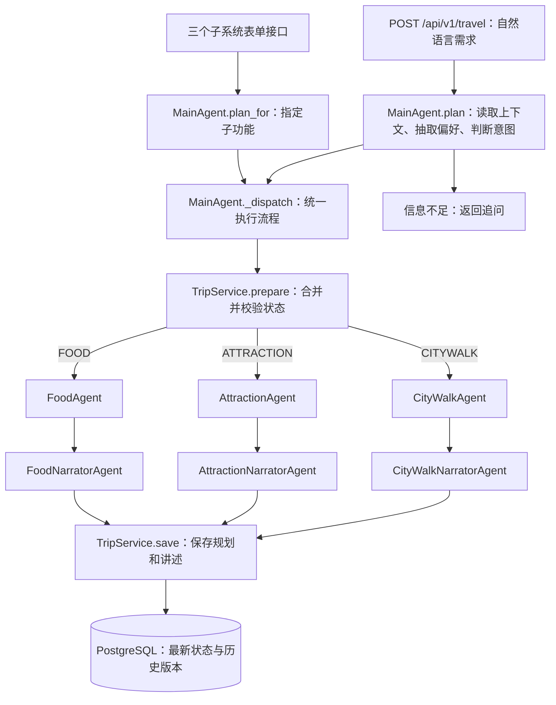

# TravelOS 项目结构与后端阅读指南

项目采用 Vue + FastAPI 前后端分离，后端按照单一职责组织：Controller 处理 HTTP，MainAgent 协调规划流程，规划 Agent 生成方案，讲述者 Agent 评价方案，TripService 管理行程状态，TripStore 负责数据库读写。

## 先看整体调用关系

系统包含 **1 个主 Agent、3 个规划 Agent、3 个讲述者 Agent**。

| 子功能 | 规划 Agent | 讲述者 Agent | 主要职责 |
|---|---|---|---|
| 城市漫步 | [CityWalkAgent](../backend/app/agents/citywalk_agent.py) | [CityWalkNarratorAgent](../backend/app/agents/narrators/citywalk.py) | 按自由偏好、顺序和当前位置逐站规划，评价主次匹配、路线节奏与步行负担 |
| 景点游览 | [AttractionAgent](../backend/app/agents/attraction_agent.py) | [AttractionNarratorAgent](../backend/app/agents/narrators/attraction.py) | 规划连续游览路线，评价兴趣匹配、停留安排与时间预算 |
| 餐厅推荐 | [FoodAgent](../backend/app/agents/food_agent.py) | [FoodNarratorAgent](../backend/app/agents/narrators/food.py) | 推荐独立备选餐厅，评价口味偏好与步行可达性 |



规划 Agent 在 `AGENT_TYPES` 中注册，讲述者在 `NARRATOR_TYPES` 中注册。每轮只执行选中的规划 Agent 及其对应讲述者。`SubAgent`、`DiscoveryAgent`、`NarratorAgent` 是共用能力的抽象基类。

## 后端目录

以下列出主要业务文件，省略普通包初始化文件。

```text
backend/
├── run.py / debug_api.py          # 启动与 WSL 调试
├── tests/                        # 离线回归测试
├── .runtime/trips.sqlite3         # 旧数据库及迁移备份（正常运行不使用）
└── app/
    ├── main.py                   # FastAPI 应用、路由注册与启动检查
    ├── config.py                 # 配置读取
    ├── dependencies.py           # ServiceResources：资源创建与连接释放
    ├── concurrency.py            # 独立 I/O 并发、失败或取消后的子任务清理
    ├── controllers/              # HTTP 参数、响应和错误处理
    │   ├── dependencies.py       # 用 Depends 组装每次请求的依赖
    │   ├── travel.py             # 自然语言入口 → MainAgent.plan
    │   ├── citywalk.py           # 漫步接口、旧版步行兼容接口
    │   ├── attraction.py         # 景点接口
    │   ├── food.py               # 餐厅接口
    │   ├── trips.py              # 历史列表、版本列表、行程详情
    │   ├── locations.py          # 起点搜索
    │   ├── maps.py               # 地图图片
    │   └── errors.py             # TravelRoute 与统一错误格式
    ├── agents/
    │   ├── main_agent.py         # 主 Agent、AGENT_TYPES、统一执行流程
    │   ├── base.py               # SubAgent：参数转换与执行契约
    │   ├── citywalk_agent.py      # 城市漫步规划
    │   ├── attraction_agent.py    # 景点游览规划
    │   ├── food_agent.py          # 餐厅备选推荐
    │   ├── discovery.py          # 景点和餐厅共用的检索、选点、路线查询
    │   └── narrators/
    │       ├── __init__.py       # NARRATOR_TYPES：三个讲述者的注册表
    │       ├── base.py           # 事实输入、结构化模型调用、失败降级
    │       ├── citywalk.py       # 城市漫步讲述者，含旧步行接口文案
    │       ├── attraction.py     # 景点游览讲述者
    │       └── food.py           # 餐厅推荐讲述者
    ├── services/
    │   ├── trip_service.py       # 状态合并、坐标转换、历史续接和保存
    │   ├── preferences.py        # 自然语言偏好抽取
    │   ├── intent_router.py      # TravelRouter：Jev 判断需求所属子功能
    │   ├── count_preferences.py  # 明确数量指令与相对增减解析
    │   ├── walk_preferences.py   # 自由偏好、补充要求 → 检索计划、顺序与末站
    │   ├── candidate_search.py   # ReAct 高德搜索、候选语义审核、不合格类别重搜一次
    │   ├── walk_routing.py       # 真实候选、当前位置路线、预算过滤与逐站Jev选择
    │   ├── plan_changes.py       # 对比真实状态与结果，生成修改说明
    │   ├── plan_result.py        # 数量不足提示、降级信息、响应组装
    │   ├── location_service.py   # 起点搜索、地址解析与去重
    │   └── map_service.py        # 地图坐标校验与图片获取
    ├── models/
    │   ├── travel.py             # 请求、状态、规划、讲述和响应模型
    │   ├── walk.py               # 步行算法及旧接口数据模型
    │   ├── postgres_trip_store.py # PostgreSQL 历史快照和版本事务
    │   └── trip_store.py          # 旧 SQLite 存储及迁移兼容
    ├── integrations/
    │   ├── amap_service.py       # 高德地点、坐标、步行路线和静态地图
    │   ├── jev_service.py        # Jev score / choice 调用
    │   ├── jev_translation.py    # 中文请求和 POI 信息的英文转换
    │   ├── llm_service.py        # LangChain 聊天模型创建
    │   ├── qweather_service.py   # 和风天气
    │   ├── unsplash_service.py   # 氛围封面
    │   └── amap_weather_service.py # 旧天气适配
    └── api/main.py               # 旧启动路径兼容
```

## 不同接口怎样进入业务

| 接口 | 调用入口 | 处理方式 |
|---|---|---|
| `POST /api/v1/travel` | `MainAgent.plan` | 根据对话确定子功能，再调用规划与讲述者 |
| `POST /api/v1/citywalk/plan` | `MainAgent.plan_for("CITYWALK", request)` | 指定城市漫步，跳过意图判断 |
| `POST /api/v1/attraction/plan` | `MainAgent.plan_for("ATTRACTION", request)` | 指定景点游览，跳过意图判断 |
| `POST /api/v1/food/search` | `MainAgent.plan_for("FOOD", request)` | 指定餐厅推荐，跳过意图判断 |
| `POST /api/v1/locations/search` | `location_service.search_locations` | 搜索起点，返回候选位置 |
| `GET /api/v1/trips` | `TripService.list_trips` | 按子功能检索规划历史 |
| `GET /api/v1/trips/{trip_id}/history` | `TripService.trip_history` | 查询一个行程的历次版本 |
| `GET /api/v1/trips/{trip_id}` | `TripService.get_trip` | 读取最新或指定版本的行程与讲述 |
| `GET /api/v1/maps/static` | `map_service.get_static_map` | 获取地点分布图 |

三个子系统接口也经过主 Agent 的统一执行流程，由已确定的规划 Agent 处理。表单跳过偏好抽取和意图判断，规划过程仍可使用选点、翻译与讲述模型。历史查询和位置搜索不创建主 Agent。

旧 `/api/walk/plan` 和 `/api/walk/map` 保留原接口格式；旧步行文案由 `CityWalkNarratorAgent.legacy_story` 处理。V1 漫步规划跳过旧文案生成，再统一调用对应讲述者。

## 每次请求的对象和连接如何管理

从 [controllers/dependencies.py](../backend/app/controllers/dependencies.py) 和 [app/dependencies.py](../backend/app/dependencies.py) 阅读这部分。

```text
HTTP 请求到来
  get_resources() 创建本次请求的 ServiceResources
    规划接口 → get_main_agent() → MainAgent
    历史接口 → get_trip_service() → TripService
    位置或地图接口 → get_amap() → AmapService
  使用所需依赖完成请求
HTTP 请求结束或抛出异常
  从 yield 处继续执行，退出 async with，异步关闭已登记的 AsyncClient
```

`Depends` 由 FastAPI 解析，可以逐层获取依赖。例如位置搜索声明 `Depends(get_amap)`，而 `get_amap` 又声明 `Depends(get_resources)`，因此位置接口无需直接调用 `get_resources()`。

对象使用普通实例。每次规划请求创建自己的主 Agent，`ServiceResources` 的 `cached_property` 让同一次请求内用到的服务按需创建一次；一个 Client 可以完成多次外部 HTTP 调用。下一个请求会创建新资源，即使来自同一个网页也一样。不同网页之间也不会共享这些请求对象。

连接由 `ServiceResources` 统一登记和释放。独立 Python 脚本中可以显式管理相同的资源范围：

```python
import asyncio
from starlette.concurrency import run_in_threadpool
from app.agents.main_agent import MainAgent
from app.dependencies import ServiceResources
from app.models.travel import TravelRequest
from app.services.trip_service import TripService

async def main():
    async with ServiceResources() as resources:
        trips = await run_in_threadpool(TripService, amap=resources.amap)
        agent = MainAgent(trips=trips, resources=resources)
        result = await agent.plan(TravelRequest(message="想在上海漫步"))
        # 信息不足时返回追问；补齐城市、起点和主题后才能规划。

asyncio.run(main())  # 只在独立脚本入口使用；FastAPI 路由里直接 await。
```

Controller、规划 Agent、偏好抽取、讲述及外部集成使用 `async def` / `await`，HTTP 调用使用 `httpx.AsyncClient`，模型使用 `ainvoke`。同轮候选路线、独立搜索与翻译可以并发；景点逐站选择仍顺序执行。同步 PostgreSQL 操作通过线程池执行，事务和版本检查保留。完整说明见 [异步执行与并发边界](ASYNC_EXECUTION.md)。

## 新建、修改与历史版本

自然语言入口先由 `TripService.previous` 读取历史并检查版本，再抽取偏好、判断意图。城市、坐标或想去的地方等必要信息不足时返回追问，暂不执行规划和讲述。漫步不再要求固定主题；兴趣主次、先后顺序和末站分别处理，见 [自由偏好与逐站规划](FREE_PREFERENCE_WALK.md)。

新建和修改最终都进入 `MainAgent._dispatch`：

1. `TripService.prepare` 合并本次参数与已有偏好，生成新状态。
2. 对应规划 Agent 执行 `execute(state)`，返回真实地点和路线。
3. `plan_result.add_count_notice` 提示目标数量与实际数量的差距。
4. 对应讲述者执行 `evaluate`，评价当前方案并说明修改。
5. `TripService.save` 校验结果标识，将规划和讲述一起保存为新版本。

修改行程有两种入口：对话修改调用 `/api/v1/travel`；表单修改继续调用对应子系统接口。两种方式都携带 `trip_id` 与最新的 `state_version`。

编辑历史版本时再提供 `base_version`：偏好和比较基准来自该历史版本，写入仍比较最新 `state_version`，成功后追加新版本。旧规划与旧讲述保留；版本冲突返回 409，原有记录不会被覆盖。

明确的数量指令，如“改成五个地点”“再加两个”，由 `count_preferences.py` 解析并沿用当前子功能，跳过偏好抽取与意图判断。相对增减基于所选版本实际返回的地点数，后续仍执行规划和讲述。数量范围及数量不足规则见 [TRAVELOS_API.md](TRAVELOS_API.md)。

## 讲述内容在哪里生成和展示

讲述者读取当前状态、已核实的规划、上一版本及本次要求。修改说明由 [plan_changes.py](../backend/app/services/plan_changes.py) 根据实际数据比较生成，覆盖数量、偏好、起点、地点增减、排序、路线指标与天气变化。

| `data.narration` 字段 | 含义 |
|---|---|
| `narrator` | 本次使用的具体讲述者名称 |
| `evaluation` | 对当前规划的评价与取舍说明 |
| `changes` | 与比较版本之间的真实修改；首次规划为空列表 |
| `based_on_version` | 比较基准版本；首次规划为 null |
| `user_request` | 本次对话原话；表单请求为 null |
| `source` | `LLM` 表示模型生成，`RULES` 表示基础评价 |

讲述者只负责评价，地点和路线由规划 Agent 决定。餐厅按独立备选评价，不把多个餐厅描述成连续游览路线。讲述环节失败时提供本子功能的基础评价，保留真实修改说明，并在 `meta.degraded_services` 中标记 `NARRATOR`。

讲述随版本保存。刷新、查询历史和恢复行程时直接读取保存内容；旧记录缺少 `narration` 时按 null 读取。前端展示位置是 [TravelResult.vue](../frontend/src/views/TravelResult.vue)，接口类型在 [types/travel.ts](../frontend/src/types/travel.ts)。

## 按职责定位修改位置

| 想修改的内容 | 优先阅读的文件 |
|---|---|
| HTTP 参数、返回格式、错误码 | `controllers/`、`models/travel.py`、`controllers/errors.py` |
| 主流程与子功能委派 | `agents/main_agent.py` |
| 需求抽取、意图判断、数量指令 | `services/preferences.py`、`intent_router.py`、`count_preferences.py` |
| 各子功能的选点与规划规则 | 对应规划 Agent；景点和餐厅共用工具在 `agents/discovery.py` |
| 候选检索、公司与真实地点区分、改词重搜 | `services/candidate_search.py`；流程见 [ReAct候选检索](REACT_CANDIDATE_SEARCH.md) |
| 各子功能的评价风格 | `agents/narrators/` 下对应讲述者 |
| 修改内容的比较规则 | `services/plan_changes.py` |
| 状态合并与历史续接 | `services/trip_service.py` |
| PostgreSQL 查询、事务和历史保存 | `models/postgres_trip_store.py` |
| 外部 API 调用及连接管理 | `integrations/`、`dependencies.py` |
| 独立 I/O 并发、取消后的任务清理 | `concurrency.py`、`agents/discovery.py` |

`TripService` 查询返回 `TripHistoryPage`、`TripSnapshot` 等领域数据；Controller 和 `plan_result.py` 负责响应组装。模型输出、路线预算、数量范围和版本冲突等校验保留在各自边界。

## 启动与验证

```bash
cd /Projects/fullstack-learning-agent/backend
conda run --no-capture-output -n agents-learn uvicorn app.main:app --host 127.0.0.1 --port 8000 --reload
conda run -n agents-learn python -m unittest discover -s tests -q
```

离线测试覆盖三个规划与三个讲述者、对话和表单修改、历史比较、旧记录兼容、讲述降级、版本冲突和资源释放，还通过事件屏障验证并发执行、每请求高德并发上限、取消清理与模型等待时的健康检查。测试使用外部服务替身；真实模型文案质量需结合实际调用检查。

接口列表见 [ROUTES.md](ROUTES.md)，字段说明见 [TRAVELOS_API.md](TRAVELOS_API.md)，静态接口定义见 [TRAVELOS_OPENAPI.json](TRAVELOS_OPENAPI.json)。
